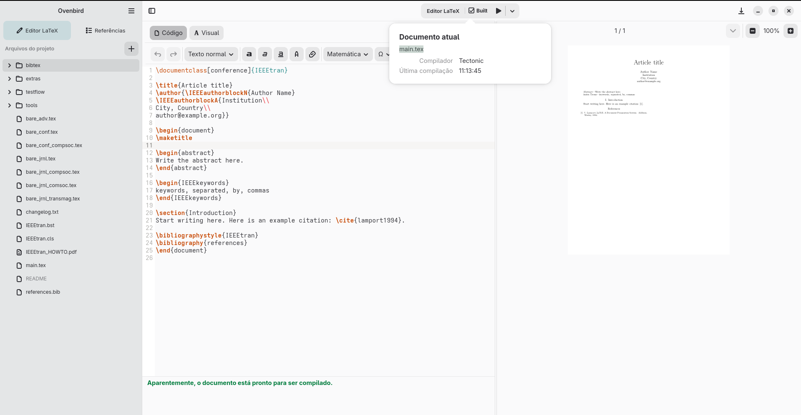
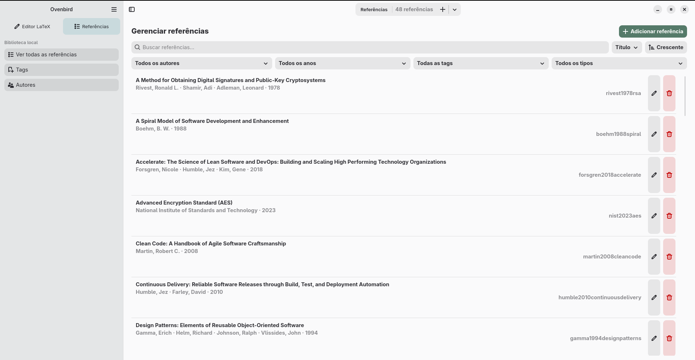

<p align="center">
  <a href="https://diegopn.github.io/ovenbird-site/">
    
  </a>
</p>

<h1 align="center">Ovenbird</h1>

<p align="center">A native GNOME workspace for writing and compiling LaTeX projects, previewing PDFs, and managing a local BibTeX library.</p>

<p align="center">
  <a href="https://github.com/diegopn/ovenbird/releases/latest">Download</a> ·
  <a href="https://diegopn.github.io/ovenbird-site/">Website</a> ·
  <a href="https://diegopn.github.io/ovenbird-site/manual/">User manual</a>
</p>

<p align="center">
  <a href="https://www.rust-lang.org/"></a>
  <a href="https://www.gtk.org/"></a>
  <a href="https://gnome.pages.gitlab.gnome.org/libadwaita/"></a>
  <a href="https://gnome.pages.gitlab.gnome.org/gtksourceview/gtksourceview5/5.0/gtkdoc/"></a>
  <a href="https://mesonbuild.com/"></a>
</p>

Ovenbird keeps LaTeX projects as ordinary files while bringing editing, compilation, PDF preview, and reference management into one desktop workspace.

## Highlights

| Workflow | What Ovenbird provides |
| --- | --- |
| Write | Code and visual editing for `.tex`, with shared undo and redo. |
| Organize | Project files and folders, plus tables, equations, images, links, notes, and citations. |
| Cite | A local BibTeX library with search, tags, import, and export. |
| Compile | `latexmk`, `pdflatex`, or Tectonic, with PDF and image previews. The Flatpak includes Tectonic. |
| Start a document | Bundled ABNT, IEEE, ACM, Elsevier, and Springer Nature templates. |

Visual mode supports a focused subset of LaTeX. Unknown commands and environments remain source text, so unsupported content is preserved.
The interface is available in English, Brazilian Portuguese, Spanish, French, and Italian.

## Screenshots

<table>
  <tr>
    <td align="center"><strong>LaTeX editor and PDF preview</strong></td>
    <td align="center"><strong>Local reference library</strong></td>
  </tr>
  <tr>
    <td></td>
    <td></td>
  </tr>
</table>

## Building from source on Linux

A native build requires GTK 4 4.20 or newer, libadwaita 1.8 or newer, GtkSourceView 5.18 or newer, and libpanel 1.10.4 or newer. Package versions vary by distribution release; for example, Debian 13 (Trixie) does not meet these minimums. Meson reports when an installed library is too old.

### Fedora and compatible RPM distributions

On Fedora, use DNF:

```sh
sudo dnf install gcc rustup pkgconf-pkg-config meson ninja-build gettext-devel gtk4-devel libadwaita-devel gtksourceview5-devel libpanel-devel desktop-file-utils unzip
```

If your compatible RPM-based distribution uses YUM, use:

```sh
sudo yum install gcc rustup pkgconf-pkg-config meson ninja-build gettext-devel gtk4-devel libadwaita-devel gtksourceview5-devel libpanel-devel desktop-file-utils unzip
```

On Fedora, run `rustup-init` once after installing `rustup`.

### Debian, Ubuntu, and derivatives

```sh
sudo apt-get install build-essential rustup pkg-config meson ninja-build gettext libgtk-4-dev libadwaita-1-dev libgtksourceview-5-dev libpanel-dev desktop-file-utils unzip
```

Use `apt` instead of `apt-get` if you prefer. Choose a release whose packages meet the version minimums above; Debian 13 stable is currently too old for a native build.

### Arch-based distributions

```sh
sudo pacman -S --needed base-devel rustup pkgconf meson ninja gettext gtk4 libadwaita gtksourceview5 libpanel desktop-file-utils unzip
```

### openSUSE Tumbleweed

```sh
sudo zypper install gcc rustup pkgconf-pkg-config meson ninja gettext-tools gtk4-devel libadwaita-devel gtksourceview5-devel libpanel-devel desktop-file-utils unzip
```

For openSUSE Leap, check that the packages in your release meet the version minimums above before building.

### Optional PDF preview

Poppler-GLib enables the embedded PDF preview. Install its development package with your distribution's package manager:

- Fedora/RPM: `sudo dnf install poppler-glib-devel` (or `sudo yum install poppler-glib-devel`)
- Debian/Ubuntu: `sudo apt-get install libpoppler-glib-dev`
- Arch: `sudo pacman -S --needed poppler-glib`
- openSUSE: `sudo zypper install libpoppler-glib-devel`

### Optional LaTeX tools

LaTeX engines are installed separately for native builds. `biblatex` projects may also need Biber:

- Fedora/RPM: `sudo dnf install latexmk texlive biber` (or `sudo yum install latexmk texlive biber`)
- Debian/Ubuntu: `sudo apt-get install latexmk texlive-latex-base biber`
- Arch: `sudo pacman -S --needed texlive-basic texlive-binextra texlive-latex texlive-bibtexextra biber`
- openSUSE Tumbleweed: `sudo zypper install texlive-scheme-basic texlive-latexmk-bin texlive-biber-bin`

### Build and test

These commands are the same on each distribution:

```sh
meson setup build
meson compile -C build
meson test -C build --print-errorlogs
```

The repository pins Rust 1.92.0, including `rustfmt` and Clippy, in `rust-toolchain.toml`; `rustup` selects that toolchain for the project. Do not install the distribution's `rust` package alongside `rustup`. The initial Rust toolchain download requires network access.

Meson invokes Cargo with `Cargo.lock` and network access disabled. Build artifacts and the Cargo home stay inside the build directory. If you already have a build directory from another Meson version, configure a new directory instead of deleting existing project files. See [CONTRIBUTING.md](CONTRIBUTING.md) for the checks to run before submitting Rust changes; GitHub Actions runs them on pushes and pull requests.

### Local Flatpak development

The in-repository manifest is intended for local builds while the packaging is being prepared. It is not yet the Flathub submission manifest.

```sh
flatpak-builder --user --force-clean .flatpak-build io.github.diegopn.ovenbird.json
flatpak-builder --user --install --force-clean .flatpak-build io.github.diegopn.ovenbird.json
flatpak run io.github.diegopn.ovenbird.Devel
```

The local development manifest uses the `.Devel` application ID so GNOME Builder and Glycin can identify an uninstalled development build correctly. The application reads `FLATPAK_ID` at startup, so its `GApplication` ID follows the selected Flatpak manifest; a native launch keeps the stable ID. This manifest uses GNOME Platform/SDK 51 and the stable Rust SDK extension. The first Tectonic build may download LaTeX support files at runtime. Creating a project from a bundled template does not require a network connection.

In GNOME Builder, use `io.github.diegopn.ovenbird.json` as the Flatpak manifest. If the build still reports `org.ovenbird.Ovenbird` or the stable ID `io.github.diegopn.ovenbird`, recreate the build configuration from the current manifest; Builder is using an old application ID.

## Data and documents

Ovenbird keeps user projects in the folders they choose. Its bibliography, author metadata, and application settings live separately:

| Data | Location |
| --- | --- |
| BibTeX library | `$XDG_DATA_HOME/ovenbird/library.bib` |
| Author catalog | `$XDG_DATA_HOME/ovenbird/authors.json` |
| Author profiles | `$XDG_DATA_HOME/ovenbird/author_profiles.json` |
| App settings | `$XDG_CONFIG_HOME/ovenbird/settings.json` |
| Build PDFs and intermediate files | Ovenbird's private cache, outside the project folder |

The bibliography remains available as standard BibTeX. Tags and author metadata use JSON sidecar files. Imported `.bib` files are added to the local library; during compilation, Ovenbird combines that library with bibliography entries declared by the project in a temporary BibTeX file. Export the library to create a permanent `.bib` file to share.

In Flatpak, `$XDG_DATA_HOME` is private to the application ID. A development build with a different ID therefore uses a separate data directory.

## Contributing

See [CONTRIBUTING.md](CONTRIBUTING.md) for development and pull request guidance. Bundled template licenses and notices are listed in [src/templates/README.md](src/templates/README.md).

## Support

Sponsorship helps with Ovenbird development, maintenance, documentation, and releases.

<p align="left">
  <a href="https://github.com/sponsors/diegopn"></a>
</p>

## License

Ovenbird is licensed under the GNU General Public License, version 3 or later. See [LICENSE](LICENSE) for the complete terms. Bundled LaTeX templates retain their own licenses and notices; see [src/templates/README.md](src/templates/README.md).
